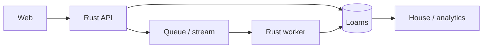

# Target architecture

- Deployment shape: one VM, light stack (or record why).
- Cloud/region: see `company/company.yaml`.
- Loams version: see `company/company.yaml`.
- Tailnet: `loams.<tailnet>.ts.net`.

## Namespaces

| Namespace | Environment | Tenants | Isolation |
|---|---|---|---|
| example-dev | dev | internal | one |
| example-prod | prod | internal | one |

## Collections

| Collection | Fields | Vector | Analyzer | Retention | Owner |
|---|---|---|---|---|---|
| example-notes | title, body, tags | 768 | default | 2 years | platform |

## Data flows

Mark each edge synchronous or asynchronous and its consistency expectation.

## Identity

See `company/architecture/identity.md`. Humans use the company OIDC issuer;
machine users and agents use Zitadel machine users with explicit grants;
authorization is OpenFGA or the built-in single-org mode.

## Network

- No inbound rule.
- Tailnet only.
- Egress: registry, GitHub, tailnet.
- Break-glass: cloud shell / Session Manager / IAP / `az vm run-command`.

## Capacity and failure

| Resource | Current | Headroom | Limit | Action |
|---|---|---|---|---|
| Disk | | | | |
| RAM | | | | |
| Bucket | | | | |
| p95 latency | | | | |

Single node: plan downtime for upgrades and restores. No failover on the light
stack.

## Decisions

| Choice | ADR |
|---|---|
| Deployment shape | D0003 |
| Tenancy | D0004 |
| Identity | D0005 |
