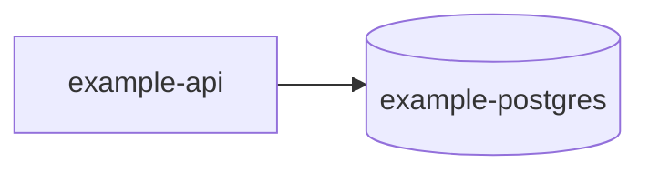

# Data map

| Store | Engine | Size | Growth | Retention | PII | Consumers | Disposition |
|---|---|---|---|---|---|---|---|
| example-postgres | PostgreSQL | | | | | | unknown |

## Flows

Mark synchronous vs asynchronous and the consistency expectation on each edge.
