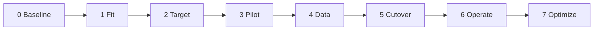

# Migration playbook

This is the method the skills enforce. It is deliberately conservative: each
stage produces an artifact, and the next stage does not start until the gate
passes.

## Stage 0 — Baseline

**Question:** what exists, who owns it, and what does it cost?

**Artifacts:** `company/stack-inventory/inventory.md`, `data-map.md`,
`risk-register.md`, optional `costs.md`.

**Gate:**
- Every service has an owner and a criticality.
- Every store has a size, growth, retention, and PII classification.
- The top three risks have a mitigation and a date.

**Skill:** `stack-inventory`.

## Stage 1 — Fit

**Question:** what does Loams replace, what stays, and what bridges?

**Artifacts:** `company/architecture/fit.md` and one ADR per component.

**Gate:**
- Every component is `replace`, `keep`, `bridge`, or `defer`.
- Every `replace` has a migration and rollback path.
- Every `bridge` has an expiry and an owner.
- No `defer` without the missing fact and who will supply it.

**Skill:** `loams-fit`, `decision-records`.

## Stage 2 — Target

**Question:** what is the topology we will build and run?

**Artifacts:** `company/architecture/target.md`, `capacity.md`, optional
`data-flows.md`, and ADRs for tenancy, identity, and deployment shape.

**Gate:**
- Namespaces, tenancy, and trust boundaries are explicit.
- The deployment shape is one VM, with the light-stack limits written down.
- Identity, network, backup, and failure domains are reviewed.
- No public engine endpoint.

**Skill:** `target-architecture`, `identity-authz`, `byog-deploy`.

## Stage 3 — Pilot

**Question:** can one bounded context run in Rust on Loams?

**Artifacts:** a service derived from `starter/`, tests, a baseline report.

**Gate:**
- Contract, integration, and conformance tests pass.
- p95 and cost are measured against the old path.
- Idempotency, consistency, and error mapping are tested.
- A rollback path exists.

**Skill:** `rust-workspace`, `loams-rust-sdk`, `conformance-testing`.

## Stage 4 — Data

**Question:** can the data move without changing its meaning?

**Artifacts:** `company/runbooks/migration-<store>.md`,
`rollback-<store>.md`, backfill and verification scripts, a migration report.

**Gate:**
- Counts and sampled hashes match.
- The top queries return equivalent results.
- Vector recall is measured on a labeled set.
- Dual-write divergence is measured, not assumed.
- Rollback is tested.

**Skill:** `data-migration`.

## Stage 5 — Cutover

**Question:** can traffic move and move back?

**Artifacts:** `company/runbooks/cutover-<service>.md`, canary report,
post-cutover review.

**Gate:**
- Canary is healthy at each ramp step.
- The rollback switch is tested and owned.
- The old path stays warm through the window.
- On-call knows the new failure modes.

**Skill:** `app-migration`, `cutover-operations`, `observability-metering`.

## Stage 6 — Operate

**Question:** can the team run this without the migration team?

**Artifacts:** `company/runbooks/operate.md`, `restore-drill.md`,
`upgrade.md`, `incident.md`.

**Gate:**
- A restore drill met the RTO.
- An upgrade was tested on a copy.
- Dashboards and alerts are live.
- Backups and bucket versioning are on.
- Revocation and key rotation are tested.

**Skill:** `cutover-operations`, `byog-deploy`.

## Stage 7 — Optimize

**Question:** is it worth it, and where is the next bottleneck?

**Artifacts:** `company/metering/`, an optimization backlog.

**Gate:**
- Cost per run is measured and within target.
- SLOs are met with headroom.
- The next migration wave is chosen from evidence.

**Skill:** `observability-metering`, `loams-adoption`.

## Roles

| Role | Owns |
|---|---|
| Executive sponsor | Scope, budget, stop/go |
| Migration lead | Stage plan, gates, cross-team blockers |
| Service owner | Contract, cutover, rollback, on-call |
| Data owner | Schema, classification, retention, migration verification |
| Platform/ops | BYOG install, backups, upgrades, restore |
| Security | Tenancy, identity, network, key management |
| Agent | Artifacts and checks, never approvals |

## Non-negotiables

1. No stage skips its gate because of a deadline.
2. No production cutover without a tested rollback.
3. No public Loams endpoint.
4. No secrets in git or logs.
5. No data deletion without the retention and legal owners.
